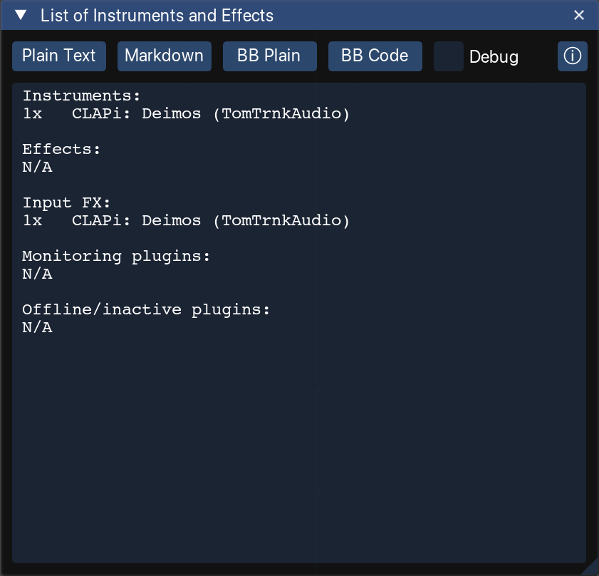

#  ListOfInstrumentsAndEffects
This is a Lua script, which lists all Reaper plugins used in an active project, grouping them into categories.
The motivation comes from KVR OSC (KVRaudio One Synth Challange) competition, which requires providing technical details of the production.



When running the script, it immediately shows results in the opened window.
Further, it provides a few buttons allowing copying the result to the clipboard.
Currently available options are:
* plain text - it's the text shown in the preview window
* markdown - results are formatted into tables using markdown syntax
* BB plain - results use some BBcode formatting, like bold
* BB [code] - results are enclosed into `[CODE] [/CODE]` BBcode tags, to force fixed-width fonts

The report refreshes itself when the project changes or you switch project tab, so it never goes stale.
Normally the report shown in the script window is plain text, regardless format selected by pressing the export button. With the `debug` checkbox checked, the report shown in the window will be the same as the content copied into the clipboard.

## What gets counted

Every FX chain REAPER offers, in five sections:

| Section | Where the plugins come from |
| --- | --- |
| Instruments | Instruments on track FX chains, on the master, and on the active take of a media item |
| Effects | Everything else on those same chains |
| Input FX | Each track's record-input FX chain |
| Monitoring plugins | The master track's input chain |
| Offline/inactive plugins | Anything bypassed or offline, plus every FX on a take that is not the one playing back |

Takes matter because REAPER lets a media item carry its own FX chain, instruments included --
that is how a MIDI item makes sound without an instrument on its track.

## Requirements

**ReaImGui 0.10 or newer**, installed through ReaPack (*Extensions → ReaPack → Browse packages*, search `ReaImGui`).
Nothing else: neither Lokasenna's GUI library nor SWS is needed.

# ReaPack

This script is published through **MXM Scripts**, which carries all of my
REAPER scripts. Import it once:

```
https://github.com/michal-bartak/ReaPack/raw/main/index.xml
```

In REAPER: *Extensions → ReaPack → Import repositories*, paste the URL, then
*Browse packages* and install **List of Instruments and Effects**.

The `index.xml` in this repository is generated by `reapack-index` and is an
input to that combined index rather than something to import directly.

## Repository layout

```
Reaper/                     mirrors REAPER's resource path; this is what gets installed
  Scripts/MXM_ListOfInstrumentsAndEffects/
    MXM_List of Instruments and Effects.lua    the window: ReaImGui only
    lib/scan.lua                               walks the project's FX chains
    lib/report.lua                             renders the four export formats
  Data/toolbar_icons/       the toolbar icon, at 1x, 150 and 200
Various/                    the ReaPack manifest, and nothing else; the directory
                            name is the ReaPack category the package is listed
                            under -- the manifest retargets every file with ../
                            so the category is not part of the install path
tests/                      headless suites for lib/, run with plain lua
icon/                       icon.svg, the master every icon output is rendered from
images/                     the screenshot the package metadata links to
index.xml                   generated by reapack-index; never edit by hand
```

Installed, that is `Scripts/MXM Scripts/MXM_ListOfInstrumentsAndEffects/` under
REAPER's resource path.

## Tests

`lib/scan.lua` and `lib/report.lua` touch neither REAPER nor ReaImGui, so they
run anywhere:

```
./tests/run.sh
```

`tests/mockreaper.lua` stands in for the ReaScript API, so the suites cover the
whole classification -- track, input, master, monitoring and take FX, active
versus inactive takes, bypassed and offline plugins -- and all four export
formats. REAPER ships Lua 5.4; `run.sh` prefers it when several are installed
and honours `LUA=/path/to/lua`.
