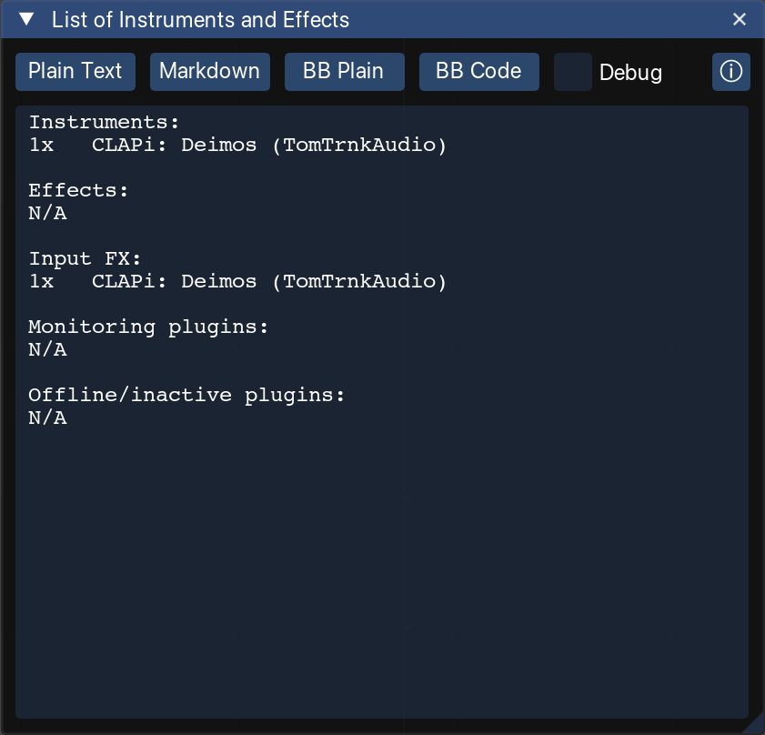

This REAPER script lists every plugin an active project uses, grouped by
category. It was written for the KVR One Synth Challenge, which asks for the
technical details of a production.

Run the action and the window shows the report at once. Four buttons copy the
report to the clipboard in different formats.

The report covers every FX chain REAPER has: tracks, track input FX, the master
track, the monitoring chain, and the FX on media items' takes. See
[What gets counted](/Reaper-ListOfInstrumentsAndEffects/counting/).

## Licence

GPL v3. Copyright (c) 2026 Michal Bartak.
